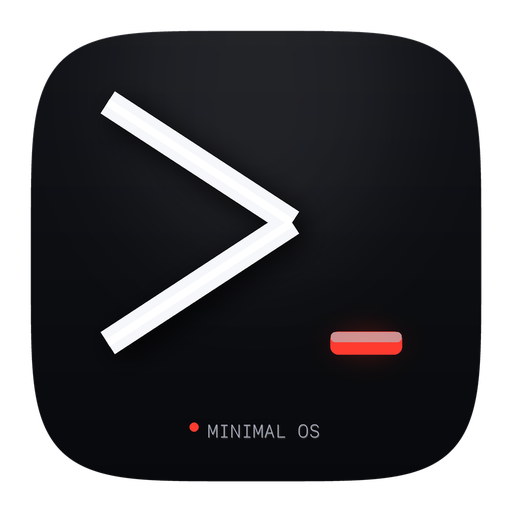
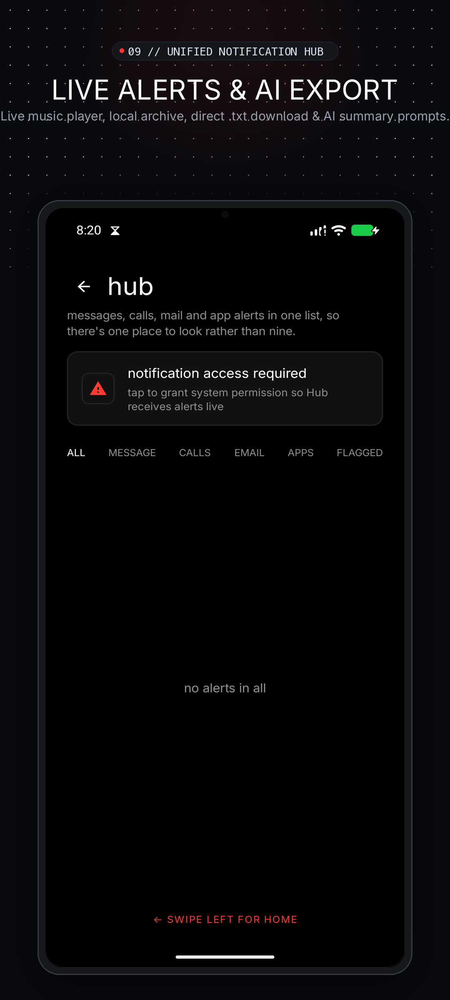

# Minimal OS Launcher

<div align="center">


<br/><br/>

[](https://github.com/zaryif/Minimal_os/actions/workflows/build.yml)
[-red.svg)](https://github.com/zaryif/Minimal_os/releases/latest)
[](https://www.android.com)
[](https://developer.android.com/jetpack/compose)
[](https://kotlinlang.org)
[](LICENSE)

**An intentional, text-first, terminal-inspired Android home launcher designed to reclaim your attention.**

*Type to do things. One hub for everything. Zero visual noise.*

[Download Latest APK (v1.9.8)](https://github.com/zaryif/Minimal_os/releases/latest) • [Interactive GIF Demos](showcase/README.md) • [Visual Showcase](#visual-overview) • [Core Features](#core-features) • [Text Graphics & Architecture](#text-graphics--feature-architectures) • [Installation](#installation--setup) • [Architecture](#architecture--tech-stack)

<br/>


</div>

---

## Visual Overview

> 🎬 **Looking for real animated demonstrations?** Check out the [Interactive GIF Showcase & Real Tasks Walkthrough](showcase/README.md) featuring live Quick Note notification bar pinning, Pomodoro focus sprints, and Notification Hub AI exports!

### 📱 Real Phone Showcase Gallery

| 01 // Pure Focus Home | 02 // Terminal Command Bar | 03 // Live Focus Sessions | 04 // Notification Hub |
|:---:|:---:|:---:|:---:|
| <a href="store_listing/graphics/screenshots/01_live_home_screen.png"></a> | <a href="store_listing/graphics/screenshots/02_command_terminal_buffer.png"></a> | <a href="store_listing/graphics/screenshots/03_live_focus_timer.png"></a> | <a href="store_listing/graphics/screenshots/09_real_notification_hub.png"></a> |
| **Typographic Home**<br/>Live clock, weather & tasks | **Terminal Chat Buffer**<br/>Numbered execution cards | **Pomodoro Sprints**<br/>Live timer on home screen | **Alerts & Music Player**<br/>Day-wise archive & AI export |

| 05 // Alphabetic Drawer | 06 // Widgets Deck | 07 // Slide-Up Scratchpad | 08 // 100% Private & Offline |
|:---:|:---:|:---:|:---:|
| <a href="store_listing/graphics/screenshots/05_alphabetical_app_drawer.png"></a> | <a href="store_listing/graphics/screenshots/06_widgets_deck.png"></a> | <a href="store_listing/graphics/screenshots/07_quick_memo_tasks.png"></a> | <a href="store_listing/graphics/screenshots/08_zero_telemetry_privacy.png"></a> |
| **Zero Icon Noise**<br/>Instant fuzzy search launcher | **Unified Utilities**<br/>Timers, alarms & Android widgets | **Quick Note & Tasks**<br/>Markdown notes in one swipe | **Zero Telemetry**<br/>100% offline local storage |

---

### 🔍 Real Device Live UI (Daily Driver in Action)

| Live Home Screen | Interactive Terminal Buffer | Live Notification Hub | 7 AMOLED Theme Palettes |
|:---:|:---:|:---:|:---:|
| <a href="store_listing/screenshots_real/01_live_home_screen_active.png"></a> | <a href="store_listing/screenshots_real/02_live_terminal_buffer.png"></a> | <a href="store_listing/screenshots_real/12_real_notification_hub.png"></a> | <a href="store_listing/screenshots_real/10_real_theme_customization.png"></a> |
| *Active Home Screen with live Pomodoro & pinned apps* | *Terminal history buffer with interactive chips & hide toggle* | *Notification Hub with live Now Playing & day-wise archive* | *High-contrast AMOLED themes with Adaptive Luminance* |

---

## What Inspired It

Modern smartphones were originally conceived as personal assistants—sharp, responsive instruments to help humans communicate, navigate, and create. Over the last decade, however, the industry transformed our home screens into brightly saturated slot machines engineered by attention merchants to trigger impulsive taps and endless algorithmic scrolling.

**Minimal OS Launcher** was born at the intersection of three distinct design movements:

1. **The Minimal Phone Paradigm**:
   Embracing typography-first minimalism, anti-dopamine layouts, and e-ink aesthetic clarity. High contrast, sharp text, and zero distracting app badges.
2. **Teenage Engineering & Hardware Aesthetics**:
   Tactile, card-based retro-futuristic interfaces. Bold contrast borders, segmented micro-cards, dedicated deck drawers, and crisp mechanical visual hierarchy.
3. **Terminal Shells & T-UI Efficiency**:
   Power users love command-line shells (Bash, Zsh) because typing commands is demonstrably faster than hunting through nested graphical menus. Minimal OS translates this command-line power to touchscreens with dedicated trigger symbols (`-`, `!`, `#`, `@`, `:`, `+`, `*`, `?`, `$`, `%`, `/`), custom shortcut aliases (`yt`, `gh`, `wifi`), and bash-like command history navigation.

---

## What Problem Is It Solving?

### 1. The Dopamine Trap of App Grids
Traditional Android home screens blast you with colorful app icons that trigger neurological dopamine loops. You unlock your phone intending to check an email or set a timer, but notice an Instagram or YouTube icon and lose thirty minutes. **Minimal OS strips away all iconography on the home screen**, replacing apps with clean, neutral typography that requires conscious intent to open.

### 2. High Friction in Mundane Daily Actions
To take a note, set an alarm for 7:30 AM, start a 25-minute Pomodoro timer, uninstall an unused app, or text a contact, traditional OS launchers force you to find an app icon, tap it, wait for splash screens, navigate internal tabs, and execute. **In Minimal OS, the Command Bar executes all of this from one line on your home screen in under two seconds.**

### 3. The "Dumb Phone" Impasse
Many people want digital detox and try purchasing hardware "dumb phones" (feature phones or e-ink phones), only to abandon them within weeks because real life requires modern tools: banking apps, WhatsApp, ride-sharing (Uber/Lyft), 2-factor authentication, music streaming (Spotify), and GPS maps. **Minimal OS turns your existing Android device into a software-defined dumb phone**: total psychological calm without sacrificing a single critical Android application.

### 4. Poor Legibility & The White-on-White Contrast Dilemma
Many monochrome or minimalist launchers suffer from contrast failures where white accents cause invisible white text on bright elements. **Minimal OS introduces the `MinimalOnAccent` adaptive luminance engine**, ensuring that whether you run pure *AMOLED Crimson* or blindingly pure *Nordic Snow*, text, badges, checkboxes, and interactive buttons automatically switch between crisp pure black (`#000000`) and brilliant white (`#FFFFFF`) for flawless WCAG AAA legibility.

---

## Core Features

### 1. Type to Do Things (The Unified Command Bar)

The Command Bar is the brain of Minimal OS. It combines instant app search, contact dialing, system utility shortcuts, natural-language actions, AI assistant prompts, YouTube queries, app uninstallation, and user-defined aliases in one unified input bar.

```
┌────────────────────────────────────────────────────────────────────────┐
│ > Type keyword or symbol + text  ───►  Instant native execution        │
└────────────────────────────────────────────────────────────────────────┘
```

| Command / Symbol | Action | Example | Result |
|:---:|:---|:---|:---|
| `qn` or `quicknote` | **Quick Note Scratchpad** | `qn Deep work until 4pm` | Pins thought to sticky notification bar and syncs with home card |
| `uninstall` or `/` | **Uninstall App** | `uninstall chatgpt` or `/chatgpt` | Prompts native confirmation dialog to uninstall the app |
| `pin` | **Pin to Home** | `pin chrome` or `pin spotify` | Pins app shortcut directly to Home screen with interactive `PIN` suggestions |
| `unpin` | **Unpin from Home** | `unpin chrome` | Removes pinned app shortcut from Home screen |
| `assistant` or `?` | **AI Assistant Query** | `assistant what is gravity` | Transmits prompt directly to Gemini, ChatGPT, Claude, or Copilot |
| `yt` or `$` | **YouTube Search** | `yt lofi beats` or `$ lofi beats` | Searches directly in the YouTube Android app or web |
| `pomo` or `%` | **Live Pomodoro** | `pomo 50m` or `pomodoro 50 minute` | Starts real-time home screen Pomodoro countdown timer |
| `@` or `msg` | **Direct SMS** | `@Mom on my way home` | Opens system SMS composer pre-filled to contact |
| `#` or `call` | **Quick Call** | `#Alex` or `#+1234567890` | Instantly dials contact or raw phone number |
| `-` or `task` | **Focus Task** | `-Buy milk and coffee` | Immediately adds task to your Minimal Memo task list |
| `!` or `note` | **Memo / Note** | `!Meeting ideas for Monday` | Saves scratch note into Minimal Memo storage |
| `*` or `event` | **Calendar Event** | `*Flight to Tokyo tomorrow` | Launches calendar intent with pre-filled title |
| `+` or `timer` | **Countdown Timer** | `+15m` or `timer 45s` | Starts a system countdown timer immediately |
| `:` or `alarm` | **Clock Alarm** | `:7:00 AM` or `alarm 8:30am` | Configures system clock alarm for specified time |
| `alias` | **Custom Shortcuts** | `alias gh = https://github.com` | Configures custom user-defined keywords (URLs, apps, or settings) |
| _(app name)_ | **Fuzzy App Search** | `spot` | Real-time app search with instant keyboard launch |
| _(search query)_ | **Web Search** | `weather today` | Fast distraction-free web search in default browser |

> **Directory of 120+ Aliases & System Shortcuts**: Check out the comprehensive [ALIASES_AND_SHORTCUTS.md](ALIASES_AND_SHORTCUTS.md) directory for ready-to-use Android settings intents (`android.settings.WIFI_SETTINGS`, `BLUETOOTH_SETTINGS`, `BATTERY_SAVER_SETTINGS`), dynamic search engines with `{query}`, app package shortcuts, and instructions on finding intent actions and package IDs.

#### Terminal Power Features:
- **Interactive Command History Stream**: When typing, past commands appear in a clean, scrollable card stream. Tap any entry to reload it into the command bar ready to edit or run.
- **Terminal Buffer Show/Hide Toggle**: Users can toggle between full terminal buffer cards and a distraction-free minimal typing line with a dedicated `[HIDE]` / `[SHOW]` header control and command bar toggle icon.
- **Terminal History Storage & Download (.md)**: All terminal commands are continuously logged to a structured markdown file (`minimal_command_history.md`). Users can export and download this `.md` file at any time from Settings using the Android Storage Access Framework.
- **Dynamic Multiline Auto-Expansion**: The command bar automatically expands from 1 line up to 3 lines when typing lengthy notes, tasks, or search queries, eliminating horizontal truncation.
- **Terminal Up/Down Cycling Controls**: Tactile Up and Down controls step through terminal history anytime with live badge tracking (`HIST 1/10`).
- **Inline Syntax Highlighting**: Only the action trigger or alias (such as `uninstall`, `pin`, `unpin`, `yt`, `pomo`, `assistant`, `todo`, `notes`, `-`, `!`, `#`) lights up in bold theme accent color, while parameters and payload text stay clean, crisp white.
- **Interactive Action Suggestions**: Typing `uninstall`, `pin`, or `unpin` displays matching installed apps with dedicated `UNINSTALL`, `PIN`, or `UNPIN` action badges. Tapping any app directly triggers the native action.

---

### 2. Quick Note & Distraction-Free Sticky Scratchpad

Minimal OS provides an instant scratchpad for thoughts, to-dos, or urgent ideas:
- **Distraction-Free Black Space**: Clean, full-bleed writing canvas designed for frictionless thought capture.
- **Sticky Notification Bar Pinning**: Notes automatically pin to your phone's notification bar as an ongoing, persistent alert (`QuickNoteManager`), keeping your core focus item visible every time you look at your phone.
- **Boot Persistence**: Restores pinned notes automatically after phone restarts via `QuickNoteActionReceiver` with `goAsync()` execution protection.
- **One-Tap Clearing & External App Sync**: Includes an inline `CLEAR` notification action and deep-link export to Google Keep, Notes, or your preferred note-taking app.

---

### 3. Unified Notification Hub & Intelligence Archive

Stop hopping between 10 different notification shades and apps. The Hub aggregates notifications into a clean, calm, and intelligent stream:
- **Category Tabs**: Filter by `ALL`, `MESSAGE`, `CALLS`, and `EMAIL`.
- **Now Playing Music Controller**: Displays live track title, artist name, and tactile play/pause/skip controls directly inside the Hub.
- **Day-Wise SQLite Archive**: Stores alerts locally in a persistent SQLite database, structured by Day of the Week, Date, and Time.
- **Hub & Settings Saving Toggle**: Complete user control over notification persistence with dedicated `● SAVE: ON` / `● SAVE: OFF` toggles right in the Hub header and in Settings.
- **Direct Download to Device (.txt)**: Export your entire notification history directly to your phone's public `Downloads/` directory using modern Android `MediaStore.Downloads` API (no legacy permission prompts).
- **1-Tap AI Summary Prompt**: Formats an executive summary prompt with your day-wise notification log, ready to send directly to Gemini, Claude, ChatGPT, or Copilot to extract urgent tasks and missed calls.

---

### 4. The Widgets Deck Screen (Dedicated Utilities Hub)

Swipe or tap into the **Widgets Deck** to access purpose-built, high-contrast utility cards inspired by retro-futuristic hardware:

- **Live Pomodoro Focus Card**: Built-in 15m, 25m, 45m, and 60m focus chips, custom duration picker dialog, work/break cycle tracker, and tactile play/pause/reset controls. Can also be pinned directly onto the **Home Screen** widgets deck with live countdown controls and matching card width.
- **Custom Alarms & Live Alarm Countdown**: Tactile custom time-picker dialog with full Hour (1–12), Minute (00–59), AM/PM toggles, and Date selection chips plus relative quick presets (`+15m`, `+30m`, `+1h`, `+8h`). Features a **Home Screen Live Alarm Countdown Widget** showing exact time remaining until the next system alarm rings.
- **Minimal Memo with Search & Direct Creation**: Full-featured quick memos and focus tasks. Includes a dedicated real-time **Search Box** to filter notes and tasks, plus a context-aware **Add Input Bar** to type and create tasks or thoughts directly without leaving the sheet.
- **Aliases & Shortcuts Deck**: Quick template creator and 1-tap launcher for your custom shortcuts (e.g. `yt` -> YouTube, `wifi` -> Network Settings, `gh` -> GitHub).
- **Countdown Timers**: Quick-tap timer presets (`1m`, `5m`, `10m`, `15m`, `25m`) that trigger native Android alarms.
- **Native App Widget Host**: Pin standard Android app widgets (Spotify, Google Keep, Weather) directly into the Minimal OS card system.

---

### 5. Handcrafted Theme Engine & Adaptive Contrast

Minimal OS includes 7 bespoke, high-contrast themes tailored for AMOLED displays, daylight readability, and aesthetic pleasure:

| Theme Name | Dominant Palette | Accent Color | Ideal Use Case |
|:---|:---|:---|:---|
| **AMOLED Crimson** | Pure Pitch Black (`#000000`) | Crimson Red (`#FF3B30`) | Maximum battery saving & classic Minimal OS look |
| **Apple Space Gray** | Deep Charcoal (`#141416`) | Electric Blue (`#0A84FF`) | Sleek, modern iOS/macOS pro look |
| **Nordic Snow** | Pure Contrast Black & Crisp White | Pure White (`#FFFFFF`) | Extreme monochrome minimalism with black-on-white text |
| **Rabbit Amber** | Warm Dark Zinc (`#0D0D0F`) | Industrial Orange (`#FF5722`) | Teenage Engineering & Rabbit r1 tribute |
| **Matrix Forest** | Deep Emerald (`#070E0A`) | Terminal Green (`#10B981`) | Cyberpunk & hacker terminal aesthetic |
| **Midnight Obsidian**| Deep Space Navy (`#060913`) | Glacier Sky (`#38BDF8`) | Calming night-time low-light readability |
| **Titanium Purple** | Shadow Violet (`#0A0714`) | Electric Violet (`#A855F7`) | Rich, vibrant dark mode aesthetic |

> **Adaptive Legibility (`MinimalOnAccent`)**: Minimal OS automatically calculates background luminance. On pure white accent buttons (Nordic Snow), text and icons dynamically render in sharp pure black (`#000000`), guaranteeing zero white-on-white visibility bugs.

---

## Text Graphics & Feature Architectures

### 1. Command Terminal Processing Pipeline

```
 USER INPUT (Command Bar)
   │
   ├── [1. Syntax Detection] ──► Action Trigger (e.g., "pomo", "uninstall", "-", "@", "qn")
   │                                   │
   ├── [2. Alias Expansion]   ◄────────┴── Custom shortcuts (e.g. "yt" -> YouTube, "gh" -> GitHub)
   │                                   │
   ├── [3. Natural Language]  ────────────► NaturalDateTimeParser ("tomorrow at 4pm", "50m")
   │                                   │
   ├── [4. Terminal Buffer]   ────────────► Numbered card stream [HIST 1/10] + [HIDE/SHOW]
   │                                   │
   └── [5. Execution Engine]  ────────────► Android System Intent (Alarm, SMS, Call, App, SAF)
```

---

### 2. Notification Hub & Intelligence Architecture

```
 ANDROID SYSTEM ALERTS (StatusBarNotification)
   │
   ▼
 MinimalNotificationService
   │
   ├── [User Toggle Filter] ──► notificationHistoryEnabled: ON / OFF
   │                                   │
   │                                   ├── [OFF] ──► Live stream only (ephemeral)
   │                                   │
   │                                   └── [ON]  ──► Local SQLite Database (1,000 alert ceiling)
   │
   ▼
 Day-Wise Formatter (Day of Week + Date + Time)
   │
   ├──► [Direct Download] ─────► MediaStore.Downloads (Saved to /Downloads/minimal_notifications_*.txt)
   ├──► [AI Prompt Export] ────► Formats prompt -> Gemini / Claude / ChatGPT / Copilot
   └──► [Now Playing Engine] ──► Live Audio MediaSession Controller (Play/Pause/Skip)
```

---

### 3. Quick Note Scratchpad & Sticky Pinning

```
 "qn Deep work until 5pm" or Slide-Up Scratchpad
   │
   ├──► Jetpack DataStore (Key: quick_note)
   │
   ├──► NotificationManagerCompat (Ongoing sticky notification bar item)
   │       │
   │       ├── Priority: PRIORITY_LOW (Calm, non-intrusive)
   │       ├── Ongoing: true (Cannot be accidentally swiped away)
   │       └── Actions: [CLEAR] button (Instantly clears note & dismisses)
   │
   └──► BootReceiver (ACTION_BOOT_COMPLETED)
           │
           └── Uses goAsync() coroutine to re-pin note after device reboot
```

---

## Android System Integration

Minimal OS is engineered specifically for Android to feel like an integral part of the operating system:

- **Target SDK 36 (Android 16 Ready)** & Backward Compatible to **Android 8.0 (Oreo, API 26)**.
- **Scoped Storage File Download**: Uses `MediaStore.Downloads` on Android 10+ (API 29+) to write plain text archives without requiring deprecated storage permissions.
- **System App Uninstallation**: Direct dispatch to `Intent.ACTION_DELETE` with package URI. For system apps, gracefully routes to App Info settings.
- **Digital Assistant Dispatch**: Direct routing to installed AI assistants (ChatGPT, Gemini, Claude, Copilot, Perplexity) via `ACTION_SEND` and `ACTION_ASSIST`.
- **System Alarm & Timer Integration**: Seamlessly dispatches intents to `AlarmClock.ACTION_SET_ALARM` and `AlarmClock.ACTION_SET_TIMER`.
- **System Calendar Intent**: Direct mapping to `CalendarContract.ACTION_INSERT`.
- **Telephony & SMS Intents**: Direct integration with default dialers and SMS apps via `Intent.ACTION_CALL`, `Intent.ACTION_DIAL`, and `Intent.ACTION_SENDTO`.
- **Native Widget Host**: Uses Android `AppWidgetManager` and `AppWidgetHost` to embed third-party widgets cleanly.
- **Zero Cloud Dependence**: 100% of your notes, todos, settings, aliases, notifications, and history remain strictly on your device in secure local storage. **No account required, no telemetry, no analytics, no ads.**

---

## Installation & Setup

### Download Latest APK
Grab the latest verified APK release directly from GitHub:

**[Download Minimal OS Launcher v1.9.8 (Build 29) APK](https://github.com/zaryif/Minimal_os/releases/latest)**

*(Or download specific tag releases from [Releases](https://github.com/zaryif/Minimal_os/releases))*

### Setting as Default Launcher
1. Download and install the `.apk` file (tap *"Install from unknown sources"* if prompted).
2. Press your phone's **Home** button or swipe up to go home.
3. When prompted, select **Minimal OS** and tap **"Always"**.
4. *(Alternatively)* Go to Android **Settings -> Apps -> Default Apps -> Home App -> Minimal OS**.

---

## Architecture & Tech Stack

```
com.zaryif.minimalos
├── data
│   ├── model          # Note, Todo, NotificationItem, App, Theme models
│   ├── preferences    # Jetpack DataStore preferences (Theme, Restrictions, Aliases, History)
│   ├── repository     # NotificationHistoryRepository, StorageRepository, ContactRepository
│   └── service        # MinimalNotificationService (Listener & Media Controller)
├── domain
│   ├── media          # MinimalMediaManager (Active MediaSession tracker)
│   ├── parser         # CommandParser & NaturalDateTimeParser
│   ├── quicknote      # QuickNoteManager & QuickNoteActionReceiver (goAsync)
│   ├── timer          # PomodoroTimerManager
│   └── usecase        # ExecuteCommandUseCase
├── ui
│   ├── apps           # AppDrawerScreen
│   ├── components     # CommandBar, MinimalCard, MinimalMemoSheet, Dialogs
│   ├── home           # HomeScreen & Live Widgets (Live Pomodoro, Live Alarm, Quick Note)
│   ├── hub            # HubScreen (Live stream, SQLite archive, media controls, AI export)
│   ├── onboarding     # OnboardingScreen
│   ├── settings       # SettingsScreen (organized by top-brand guidelines)
│   ├── theme          # Adaptive Theme, MinimalOnAccent Luminance Engine
│   └── widgets        # WidgetsDeckScreen (Pomodoro, Alarms, Aliases, Timers, WidgetHost)
└── util               # NotificationExporter (MediaStore.Downloads, AI Prompts, Clipboard)
```

- **Language**: Kotlin 2.0+
- **UI Framework**: Jetpack Compose (Material3)
- **Asynchronous Flow**: Kotlin Coroutines & `StateFlow` / `SharedFlow`
- **Preferences & Storage**: Jetpack DataStore & SQLite (Local Room/SQLite)
- **Build System**: Gradle Kotlin DSL (`build.gradle.kts`)

---

## Documentation Suite

Comprehensive architecture, audit, and design documentation is available in the [`docs/`](docs/) directory:
- [Codebase Audit & Review (Ponytail Quality Audit)](docs/CODEBASE_AUDIT_AND_REVIEW.md)
- [Business Requirements Document (BRD)](docs/BRD.md)
- [Software Requirements Specification (SRS)](docs/SRS.md)
- [Software Architecture Document (SAD)](docs/SAD.md)
- [Management Information System (MIS)](docs/MIS.md)
- [Master Plan](docs/Minimal_OS_Launcher_Master_Plan.md)

---

## License

This project is licensed under the [MIT License](LICENSE).

Developed with pride by **MD. Zarif Azfar** ([@zaryif](https://github.com/zaryif)).
