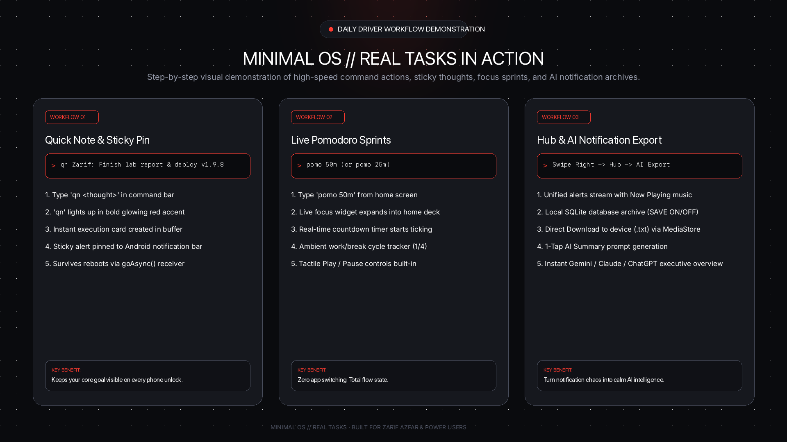
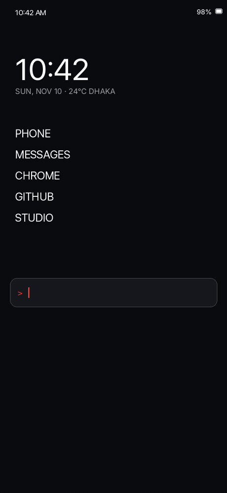
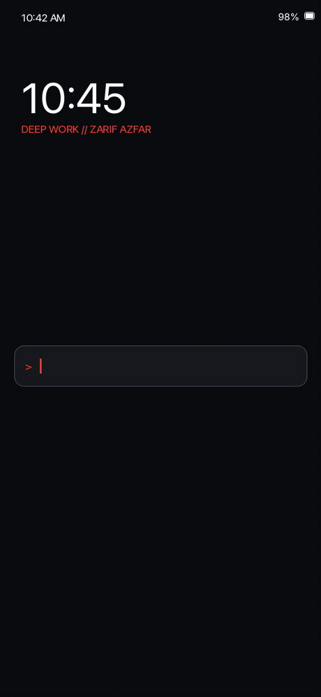
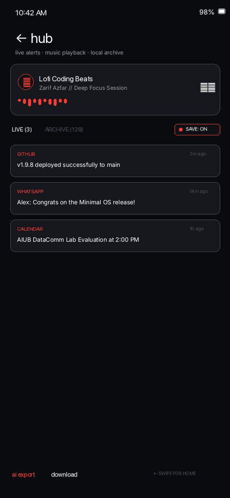

# Minimal OS // Real Task Demonstrations & Animated GIF Showcase

<div align="center">



**Real, step-by-step visual walkthrough of Minimal OS in action.**
*Featuring real daily-driver tasks by Zarif (MD. Zarif Azfar).*

</div>

---

## 1. Quick Note & Sticky Notification Bar Pinning

### 🎬 Live Demonstration
<div align="center">
  
</div>

### 🛠️ The Command
```bash
> qn Zarif: Finish lab report & deploy v1.9.8
```

### 🔍 How It Works in Minimal OS:
1. **Instant Thought Capture**: Start typing `qn` in the Command Bar. The trigger `qn` automatically lights up in bold crimson red (`#FF3B30`).
2. **Context-Aware Suggestion**: A preview card dynamically appears above the input line: `[📌 PIN TO NOTIFICATION BAR]`.
3. **Execution Card Stream**: Hitting `Enter` logs the task to the scrollable terminal buffer card `#1` with an active `PINNED` badge.
4. **Sticky Notification Bar Pinning**: `QuickNoteManager` creates an ongoing, persistent Android notification with priority `PRIORITY_LOW`. It cannot be accidentally swiped away, ensuring your core focus thought is front and center every time you pick up your phone.
5. **Reboot Persistence**: The note survives phone restarts thanks to `QuickNoteActionReceiver` with `goAsync()` coroutine protection.
6. **One-Tap Dismiss & Export**: Tap `CLEAR` right on the notification shade to dismiss it, or tap `OPEN KEEP` to transfer it to your notes app.

---

## 2. Live Pomodoro Focus Sprint

### 🎬 Live Demonstration
<div align="center">
  
</div>

### 🛠️ The Command
```bash
> pomo 50m
```
*(Also supports `pomodoro 25 minute`, `pomo 15m`, or tapping quick presets in the Widgets Deck)*

### 🔍 How It Works in Minimal OS:
1. **Zero App Switching**: Instead of opening a heavy timer app and getting distracted by social notifications, type `pomo 50m` directly on your home screen.
2. **Live Home Screen Countdown**: The live Pomodoro card smoothly animates onto your home screen widgets deck.
3. **Real-Time Ticking Engine**: Watch seconds count down (`49:59`, `49:58`, `49:57`...) with an animated glowing red progress bar.
4. **Work / Break Cycle Tracker**: Displays your current sprint progress (`SPRINT 1/4`) and upcoming 5m/15m breaks.
5. **Tactile Hardware Controls**: Built-in Play/Pause and Reset buttons allow instant session control without leaving your home screen.

---

## 3. Notification Hub, Day-Wise Log & AI Summary

### 🎬 Live Demonstration
<div align="center">
  
</div>

### 🛠️ The Gesture & Action
```
Swipe Right from Home Screen ──► Hub ──► [DOWNLOAD] or [AI EXPORT]
```

### 🔍 How It Works in Minimal OS:
1. **Calm Unified Alerts**: Aggregates all Android notifications into a clean typography stream categorized by `ALL`, `MESSAGE`, `CALLS`, and `EMAIL`.
2. **Now Playing Audio Controller**: Displays live track metadata (`♫ Lofi Coding Beats - Zarif Azfar`) with animated audio waveform bars and direct play/pause/skip controls.
3. **User-Controlled SQLite Archive**: Toggle `● SAVE: ON` / `● SAVE: OFF` right from the Hub header or in Settings. When enabled, alerts are preserved locally (up to 1,000 alerts).
4. **Day-Wise Formatting**: Every alert is logged with Day of the Week, Date, and Time:
   ```
   [SUNDAY, NOV 10 · 10:42 AM]
   App: GitHub
   Title: Release v1.9.8 deployed successfully
   ```
5. **Direct Download to Device (.txt)**: Tap `download` to write a formatted archive directly to your phone's public `Downloads/` directory using modern Android `MediaStore.Downloads` API without legacy permission gates.
6. **1-Tap AI Summary Prompt**: Tap `ai export` -> `send to ai assistant` to package your notification history into an executive summary prompt for Gemini, Claude, ChatGPT, or Copilot.

---

## 4. Cheat Sheet: Zarif's Daily Minimal OS Commands

| Command / Symbol | Real Task Example | What Happens |
|:---|:---|:---|
| `qn <thought>` | `qn Zarif: Deploy v1.9.8 & finish lab report` | Pins thought to sticky notification bar & home card |
| `pomo <duration>` | `pomo 50m` | Starts real-time home screen Pomodoro focus countdown |
| `uninstall <app>` | `uninstall tiktok` or `/instagram` | Prompts native confirmation dialog to uninstall distraction app |
| `pin <app>` | `pin spotify` or `pin chrome` | Pins app shortcut to home screen with interactive suggestions |
| `unpin <app>` | `unpin spotify` | Removes pinned app shortcut from home screen |
| `assistant <prompt>` | `assistant summarize today's notifications` | Sends structured prompt to Gemini / Claude / ChatGPT |
| `yt <query>` | `yt lofi beats for coding` | Searches directly in YouTube app or web |
| `@<contact>` | `@Alex on my way home` | Opens system SMS composer pre-filled to contact |
| `#<contact>` | `#Alex` or `#+1234567890` | Instantly dials phone number |
| `-<task>` | `-Buy coffee & verify server logs` | Immediately adds item to Minimal Memo task list |
| `!<note>` | `!Meeting ideas for tomorrow` | Saves scratch note to local storage |
| `*<event>` | `*AIUB DataComm Lab Presentation at 2pm` | Launches calendar intent with pre-filled title and time |
| `:<time>` | `:7:00 AM` or `alarm 8:30am` | Configures system clock alarm |
| `+<timer>` | `+15m` or `timer 45s` | Starts system countdown timer |
| `alias` | `alias gh = https://github.com` | Creates custom instant shortcut |

---

## Summary of Media Assets

- **Quick Note Pinning GIF (96 KB)**: [`01_quicknote_sticky_pinning.gif`](gifs/01_quicknote_sticky_pinning.gif)
- **Pomodoro Focus Sprint GIF (50 KB)**: [`02_pomodoro_focus_sprint.gif`](gifs/02_pomodoro_focus_sprint.gif)
- **Notification Hub & AI GIF (104 KB)**: [`03_notification_hub_ai_and_download.gif`](gifs/03_notification_hub_ai_and_download.gif)
- **Master Workflow Graphic (112 KB)**: [`real_tasks_workflow_showcase.png`](graphics/real_tasks_workflow_showcase.png)

